

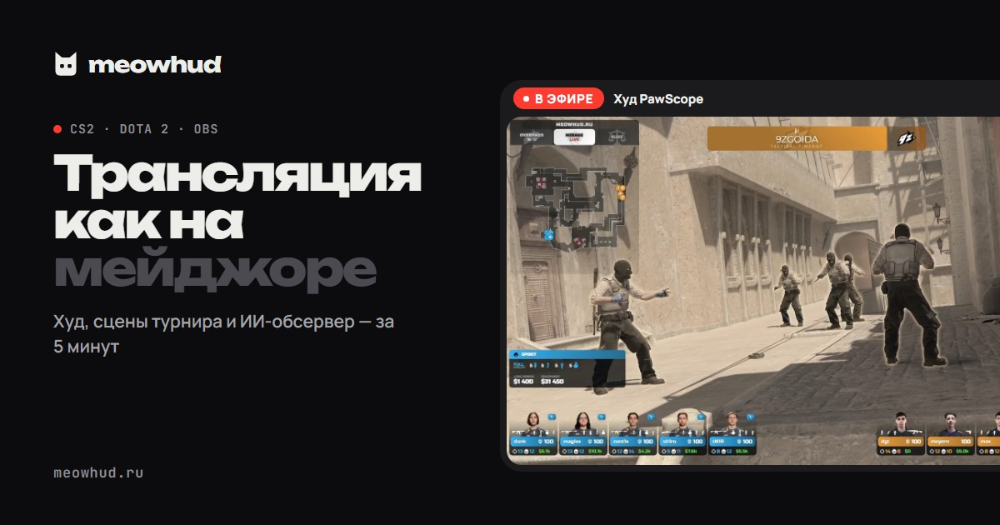

# MeowHUD

**HUD и эфирные сцены для трансляций CS2 и Dota 2**

Худ в цветах вашего турнира, вето карт, расписание, перерыв, титры, студия продюсера и ИИ-обсервер. 
Одна программа для Windows, настройка за 5 минут, интерфейс и поддержка на русском.

[Русский](#русский) · [English](#english)

---

## Русский

MeowHUD — программа для тех, кто показывает CS2 и Dota 2 в эфире: организаторов турниров, студенческих лиг, обсерверов и стримеров. Она берёт данные прямо из игры (Game State Integration) и выводит профессиональную графику в OBS или поверх игры.

**Скачать:** зарегистрируйтесь на [meowhud.ru](https://meowhud.ru) и нажмите «Скачать» в личном кабинете. Первые 48 часов бесплатно, отсчёт начинается с первого запуска программы.

### Худ для CS2 и Dota 2

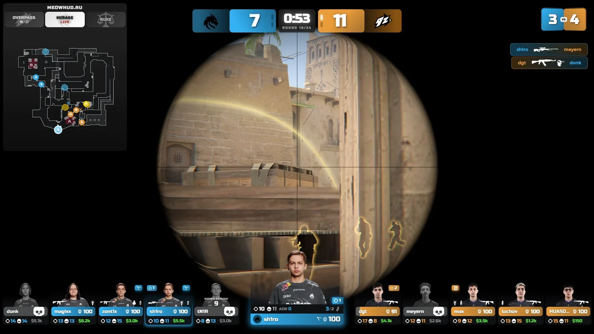 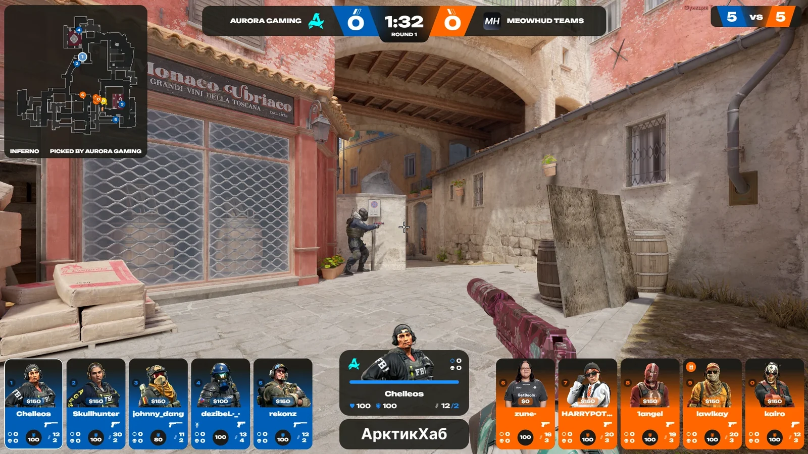

- Готовые худы для CS2 и Dota 2: счёт, игроки, экономика, радар, бомба, киллфид, MVP раунда.
- **Свои цвета сторон** и логотипы команд: худ выглядит как часть вашего турнира.
- **Конструктор худов**: соберите свой худ из готовых компонентов разных стилей, без программирования.
- **Камеры игроков** прямо в худе: игрок открывает ссылку в браузере, и его вебка появляется на трансляции.
- **X-ray в цветах команд** через HLAE и зум радара.
- **Оверлей поверх игры** без OBS, если стримите с того же компьютера.

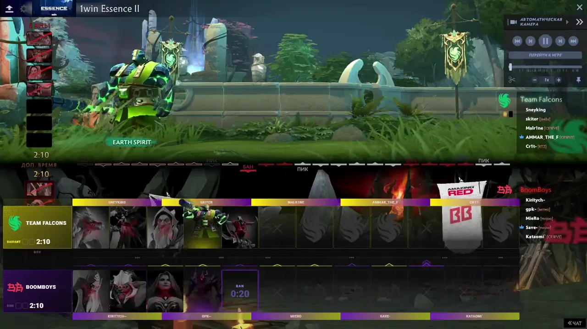

### Сцены эфира

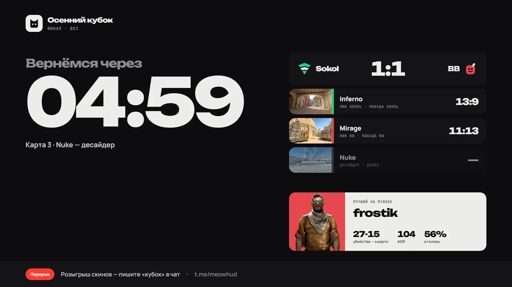 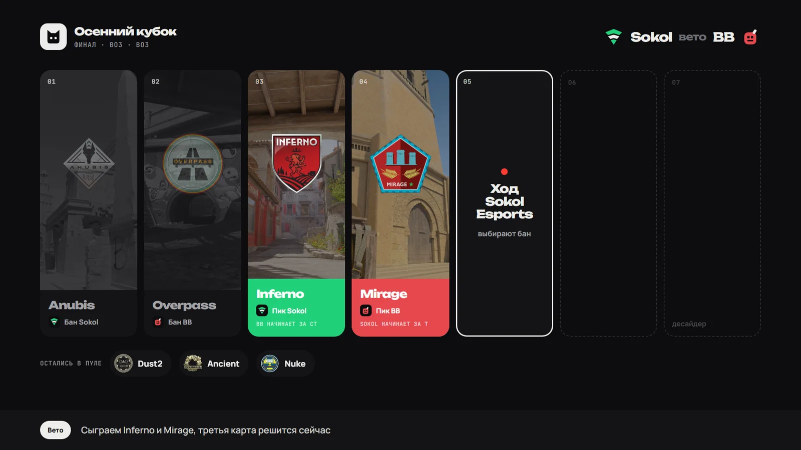
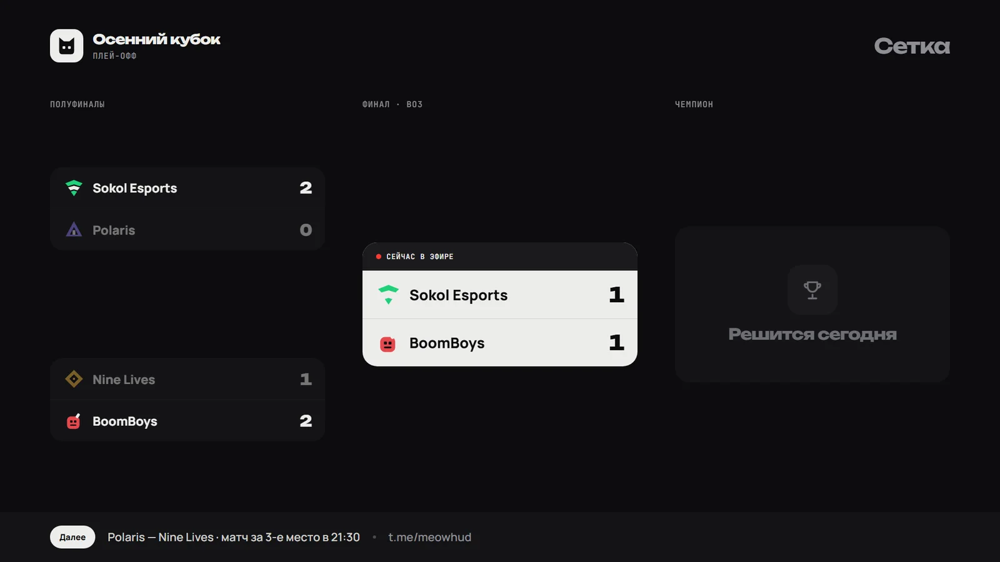 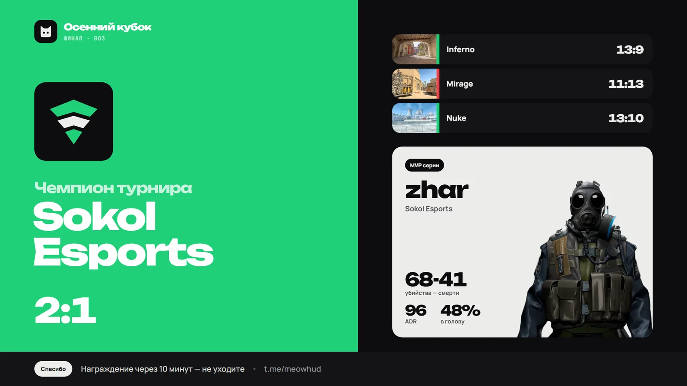

13 сцен в одном стиле: заставка, интро матча, составы, ведущие, спонсоры, перерыв с таймером, статистика карты, победа, расписание, таблица, сетка турнира, пауза и титр. Счёт, вето, расписание и сетка подтягиваются сами из матча в программе, руками ничего править не нужно.

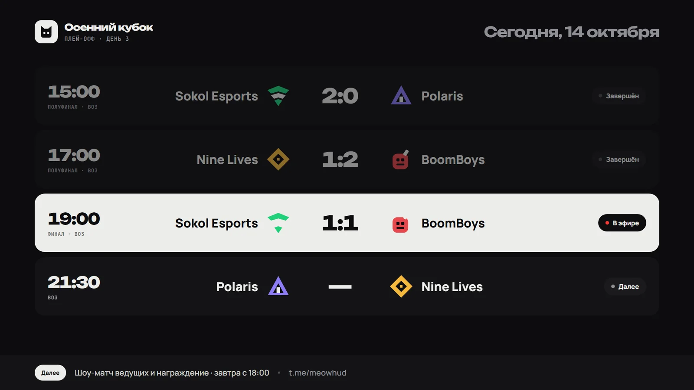 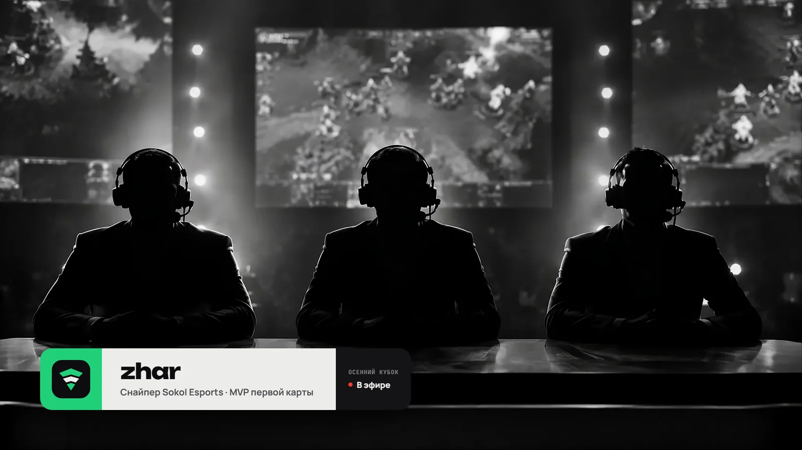

### Матчи и вето

- Матчи BO1, BO3, BO5, счёт серии и автосмена сторон.
- **Вето карт по ссылкам для капитанов**: команды сами банят и пикают карты, а результат сразу попадает в худ и сцены.
- База команд и игроков с фото, логотипами и SteamID.
- Турнирные сетки.

### Студия продюсера

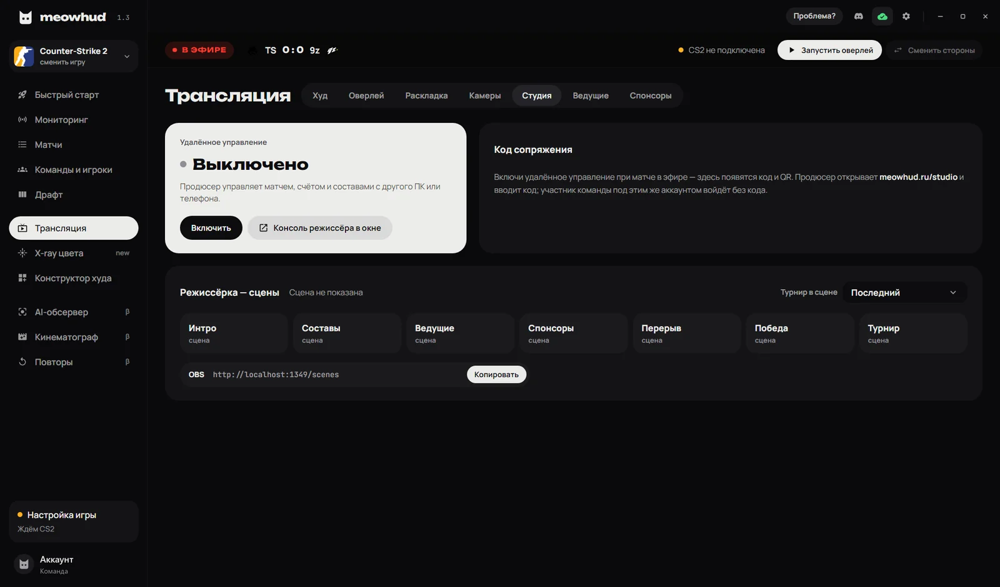

Режиссёр управляет эфиром с телефона или второго компьютера: меняет счёт, записывает результаты карт, переключает сцены, худ и спонсоров. Оператор в это время занят игрой и OBS. Подключение по 6-значному коду или QR.

### ИИ-обсервер и повторы (CS2, бета)

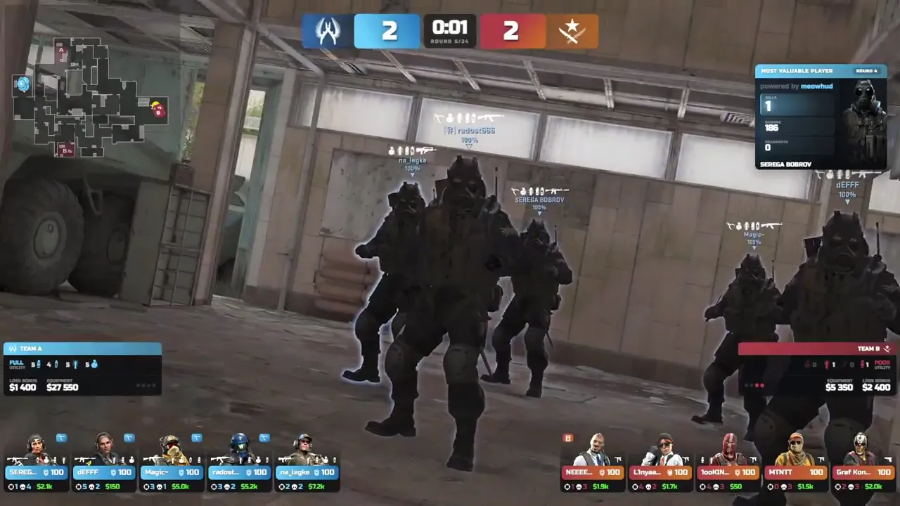

- **ИИ-обсервер** сам выбирает, за кем следить в раунде.
- **ИИ-кинематограф** делает пролёты камеры во фризтайме и паузах.
- **Авто-повторы** лучших моментов раунда.

### Настройка за 5 минут

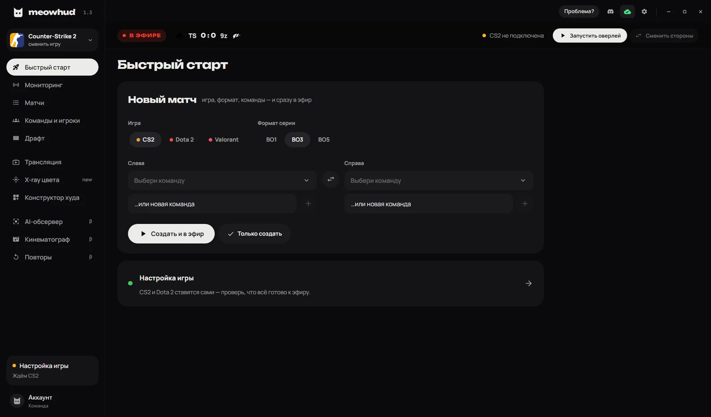

Программа сама включает передачу данных в CS2 и Dota 2, запускает игру и создаёт сцену в OBS. Нет матча под рукой — включите демо-матч: худ покажет запись настоящей игры.

### Тарифы

| | Стартер | Про | Организатор | Команда |
|---|:---:|:---:|:---:|:---:|
| Месяц | 790 ₽ | 1 990 ₽ | 2 990 ₽ | 5 590 ₽ |
| Неделя | 290 ₽ | 690 ₽ | 990 ₽ | 1 890 ₽ |
| Худ без водяного знака, вето, турниры | ✓ | ✓ | ✓ | ✓ |
| Премиум-худы, свои цвета, камеры игроков | | ✓ | ✓ | ✓ |
| Сцены эфира и студия продюсера | | | ✓ | ✓ |
| ИИ-обсервер, часов в месяц | 3 | 6 | 8 | 12 |

Год на 20 % дешевле. Подробно в [документации](https://guide.meowhud.ru/docs/plans/overview) и на [meowhud.ru](https://meowhud.ru/#pricing).

### Требования

Windows 10 или 11 (64-bit), 8 ГБ ОЗУ, CS2 и/или Dota 2 в Steam. OBS или любая программа с источником «Браузер».

### Поддержка

- Документация: [guide.meowhud.ru](https://guide.meowhud.ru)
- Telegram: [@meowhud](https://t.me/meowhud)
- Почта: [support@meowhud.ru](mailto:support@meowhud.ru)
- Discord: [discord.gg/6Dddscg38H](https://discord.gg/6Dddscg38H)

Нашли ошибку? Откройте [issue](../../issues/new/choose) или напишите в Telegram.

---

## English

MeowHUD is a Windows app for **CS2 and Dota 2 tournament broadcasts**: a live HUD, broadcast scenes, map veto, a remote producer studio and an AI observer. It reads game data via Game State Integration and renders broadcast graphics in OBS (Browser Source) or as an overlay on top of the game.

**Download:** sign up at [meowhud.ru](https://meowhud.ru) and press “Download” in your dashboard. 48-hour free trial that starts on the first launch.

**Features**

- **HUD for CS2 and Dota 2**: score, players, economy, radar, bomb, killfeed, round MVP; custom side colors and team logos.
- **HUD composer**: build your own HUD from ready-made components in several styles, no code required.
- **Player webcams** inside the HUD: players open a link in a browser and their camera appears on air.
- **13 broadcast scenes**: starting soon, match intro, lineups, casters, sponsors, break timer, map stats, victory, schedule, standings, bracket, pause, lower third. Scores, veto and schedule update automatically.
- **Map veto with captain links**, BO1/BO3/BO5 series, automatic side switching, team and player database, tournament brackets.
- **Producer studio**: control the broadcast from a phone or a second PC with a 6-digit code.
- **AI observer, AI cinematic camera and auto replays** for CS2 (beta).
- **X-ray in team colors** via HLAE, radar zoom, in-game overlay without OBS.
- **5-minute setup**: GSI config, game launch and OBS scene are created automatically; a demo match works without the game.

The interface and support are in Russian. Pricing: [meowhud.ru/#pricing](https://meowhud.ru/#pricing).

---

© MeowHUD. Этот репозиторий содержит описание и медиа, а не исходный код программы. 
Counter-Strike 2 и Dota 2 являются товарными знаками Valve Corporation. MeowHUD не связан с Valve.

